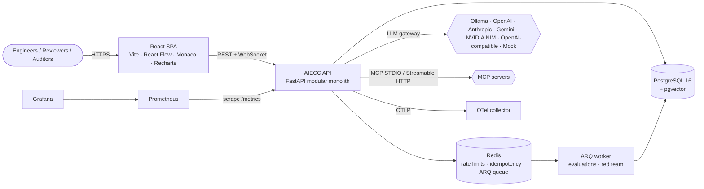
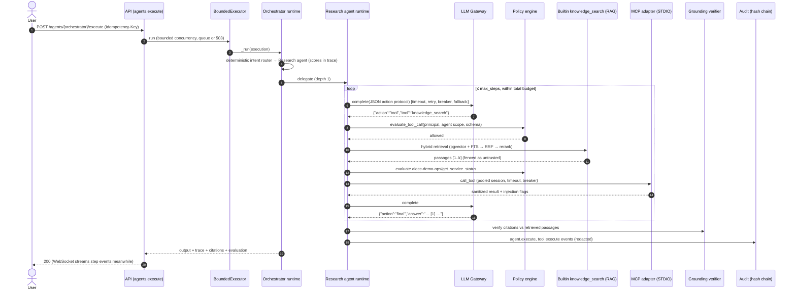
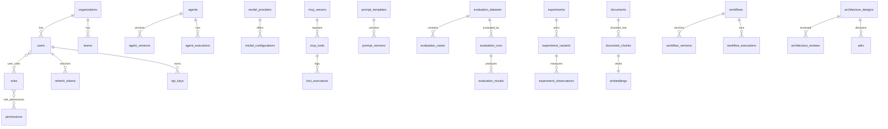

# AIECC Architecture

## 1. Context

## 2. Layers (modular monolith, ADR-0001)

| Layer | Package | Responsibility |
|---|---|---|
| Presentation | `frontend/src` | SPA; RBAC-aware navigation; never holds secrets |
| API | `app/api/v1/*` | HTTP contracts (OpenAPI), validation (Pydantic v2), authN/authZ dependencies, pagination, idempotency |
| Application / use cases | `app/agents`, `app/rag`, `app/evaluations`, `app/experiments`, `app/workflows`, `app/architecture`, `app/codereview`, `app/services` | Orchestrate domain logic; transactional boundaries |
| Domain | `app/domain`, `app/security/policy.py`, `app/security/rbac.py` | Typed configs, lifecycle state machines, policy rules |
| Infrastructure | `app/core` (config, db, redis, resilience, jobs, logging), `app/models` | Persistence, pools, primitives |
| Integration / adapters | `app/integrations/{llm,mcp,tools,vector_store}` | Provider adapters, MCP client adapters, vector stores |
| Observability | `app/observability` | Prometheus metrics, rolling percentile window, OTel tracing, event bus |

Patterns: **Adapter** (LLM providers, tool adapters, vector stores), **Strategy** (retrieval strategies, rerankers, scorers),
**Factory** (`build_provider`, `build_adapter`), **Repository-style tenant scoping** (`get_owned`, `paginate`),
**Dependency injection** (FastAPI `Depends` for DB session and principal), **Event-driven** UI updates (in-process bus → WebSocket).

## 3. Flagship scenario: Enterprise Research Agent

Telemetry: each LLM/tool/agent/retrieval call emits an OTel span, a Prometheus histogram observation and a
`usage_metrics` row (tokens, cost, latency, mock flag). The dashboard reads only those sources.

## 4. Data model (38 tables, Alembic `0001`)

All tenant tables carry `organization_id` (FK, indexed). Notable indexes: HNSW on `embeddings.vector`
(cosine), GIN on `to_tsvector('english', document_chunks.content)`, GIN `jsonb_path_ops` on `documents.metadata`,
`(organization_id, created_at)` on executions/usage/audit, unique `(organization_id, chain_index)` on audit events.
`audit_events` has BEFORE UPDATE/DELETE/TRUNCATE triggers that raise.

## 5. Concurrency & resilience

| Concern | Mechanism | Where |
|---|---|---|
| Unbounded autonomy | `max_steps` ≤ hard limit, total budget, delegation depth 1 | `agents/runtime.py` |
| Overload | `BoundedExecutor` semaphore + bounded wait queue → 503 `Retry-After` | `core/resilience.py` |
| Slow / failing deps | per-call timeouts, jittered retries, circuit breakers (LLM, embeddings, each MCP server), fallback model routes | `integrations/llm/gateway.py`, `services/tool_service.py` |
| Abuse | fixed-window rate limiting (Redis or in-memory), stricter on `/auth/login`; account lockout | `api/middleware.py`, `api/v1/auth.py` |
| Duplicate submits | `Idempotency-Key` response replay (24 h) | `api/common.py` |
| Event-loop blocking | Argon2 offloaded with `asyncio.to_thread`; HTTP via pooled `httpx.AsyncClient` | `security/crypto.py` |
| Slow consumers | bounded per-subscriber WebSocket queues, drop-oldest | `observability/events.py` |
| Batching | embeddings sent in batches of 64 | `gateway.embed` |
| Graceful shutdown | stop intake → wait in-flight executions (10 s) → cancel → drain jobs → close MCP sessions, HTTP pools, Redis, DB | `main.py` lifespan |
| Cancellation | task registry; `POST /executions/{id}/cancel` → persisted `cancelled` | runtime |

## 6. Trust boundaries

1. Browser ↔ API: JWT bearer / API key; CORS allowlist; security headers; no tokens in URLs (WebSocket auth by first message).
2. API ↔ model providers: credentials server-side only (env or Fernet-encrypted rows); responses treated as untrusted text.
3. API ↔ MCP servers: allowlisted STDIO commands, minimal child env, authenticated HTTP transports, deny-by-default tools,
   sanitized + size-bounded outputs, policy engine before every call.
4. API ↔ external HTTP (workflow API nodes): hostname allowlist, private/loopback IP block, no redirects.
5. Tenant ↔ tenant: organization filter on every query; foreign IDs return 404 (tested).
